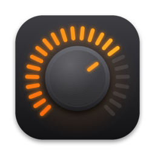
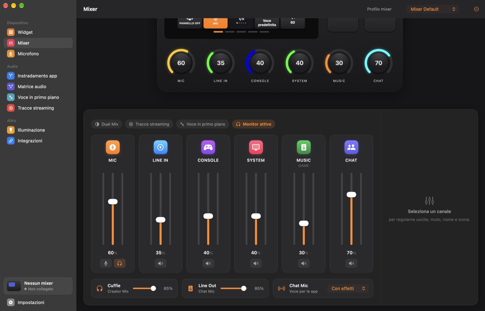
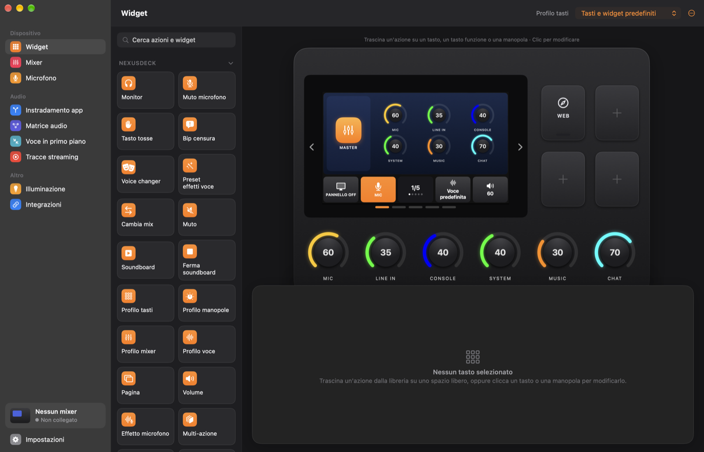
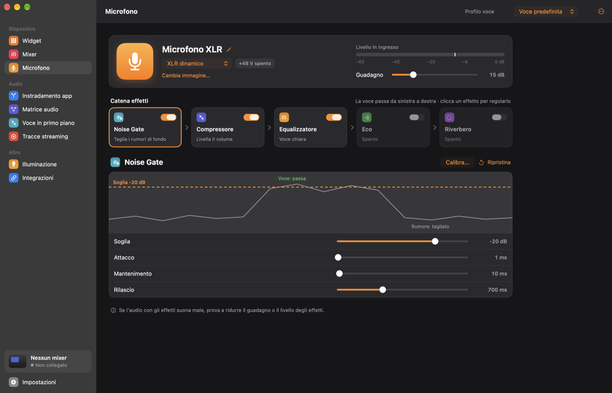
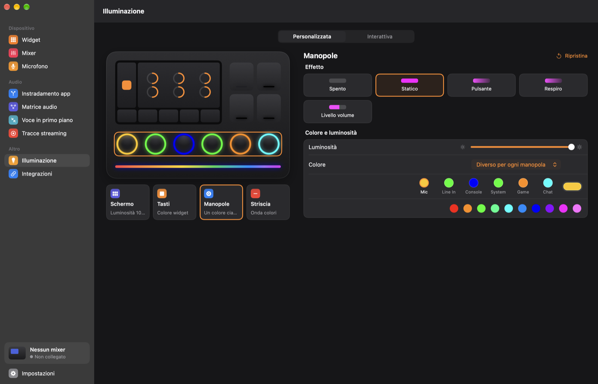
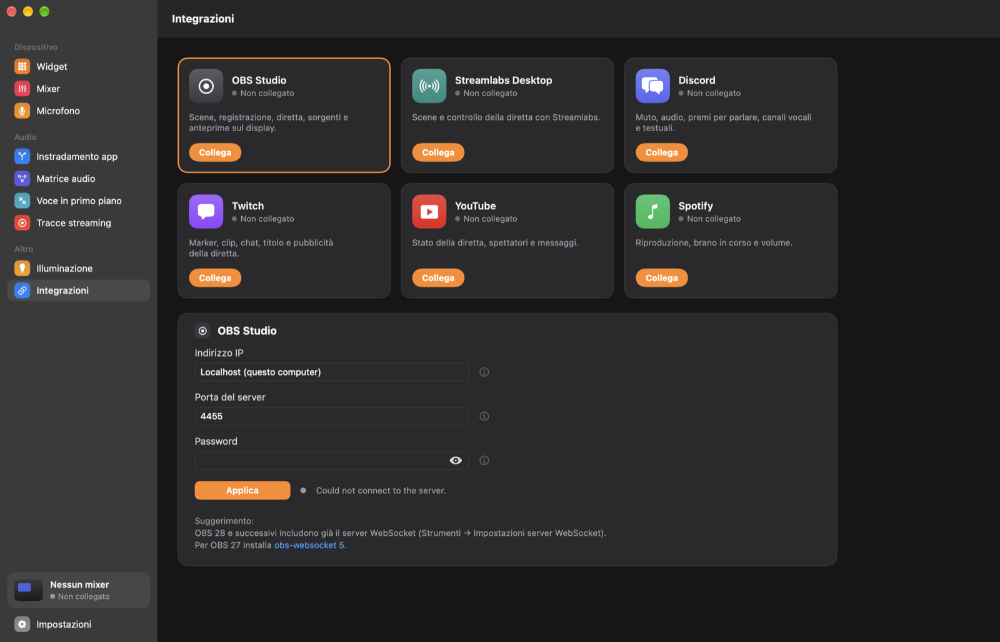
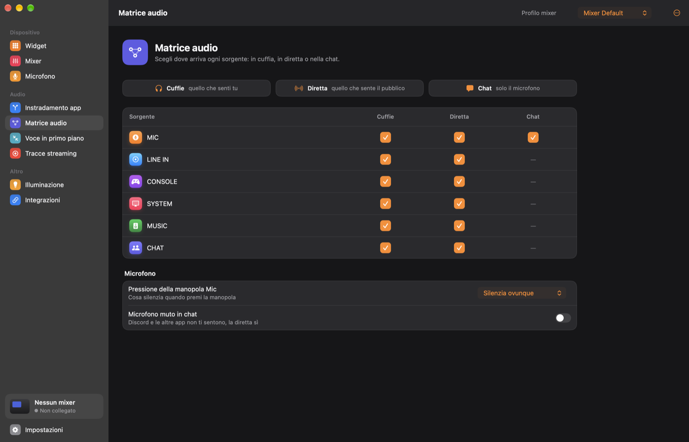
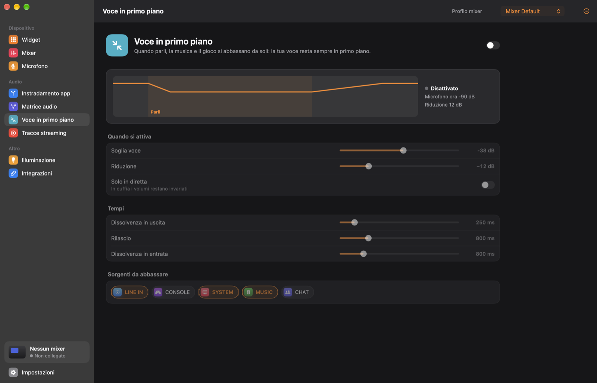
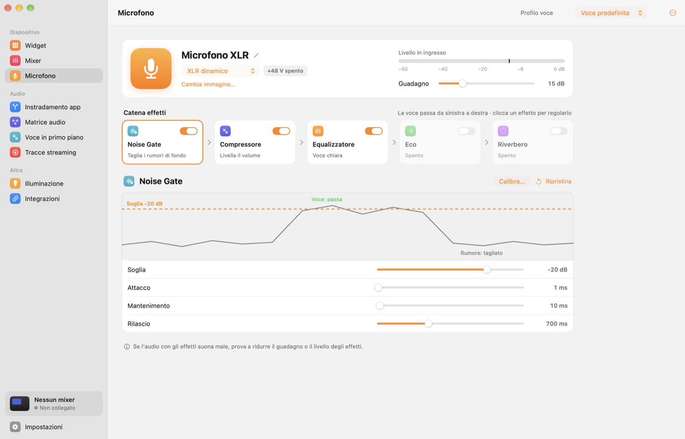

<p align="center">
  
</p>

<h1 align="center">NexusDeck</h1>

<p align="center">
  A native macOS app to control the <b>AX310</b> mixer / stream deck.<br>
  Designed like a Mac app should be: native sidebar, light and dark appearance, built for Apple Silicon.
</p>

<p align="center">
  <a href="../../releases/latest"><b>Download the latest release</b></a>
</p>

<picture>
  <source media="(prefers-color-scheme: light)" srcset="docs/screenshots/mixer-light.png">
  
</picture>

> NexusDeck is an independent project and is **not affiliated with, endorsed or supported by AVerMedia**. "AX310" is mentioned only to identify the compatible hardware.

## A look inside

| | |
|:---:|:---:|
| <br>**Widget** — drag actions onto keys, knobs and function keys | <br>**Microphone** — effect chain with live graphs |
| <br>**Lighting** — every LED zone, previewed in real colours | <br>**Integrations** — OBS, Streamlabs, Discord, Twitch, YouTube, Spotify |
| <br>**Audio matrix** — choose where every source goes | <br>**Voice priority** — music and game step back when you speak |

<p align="center">
  <br>
  <sub>Follows your Mac's light or dark appearance.</sub>
</p>

## Requirements

- Mac with **Apple Silicon** (M1 or later)
- **macOS 14** or later
- AX310 mixer connected via USB

## Features

- Keys and widgets on the touch panel, pages, folders, multi-actions
- Audio mixer: Single/Dual Mix, vertical channel strips, volumes, mutes, mic monitoring, level meters
- Microphone: gain, 48V phantom power, live input meter, effect chain (noise gate, compressor, equalizer, echo, reverb) with live graphs and presets
- Lighting for screen, keys, knobs and LED strip, plus interactive live / recording lights
- Integrations: OBS, Streamlabs Desktop, Twitch, YouTube, Spotify, Discord
- Works without the mixer too: prepare keys and profiles offline

## New in NexusDeck (not available in the original software)

- **Per-app audio routing**: send any app (e.g. Spotify, Chrome, Discord) to a mixer channel (System, Game, Chat, Line In, Console) and control it with that channel's knob. Routing happens inside the NexusDeck audio driver: no extra latency, no screen/audio-recording permission, and changes apply instantly while audio is playing.
- **Interactive routing matrix**: choose, for every source, whether it goes to your headphones, to the stream and (for the mic) to chat, e.g. music in your headphones but not on stream.
- **Mic mute modes**: mute the mic everywhere, only on stream, or only in chat (Chat Mic), from the Mic knob or a key.
- **Cough key**: hold a key to mute the mic, release to unmute.
- **Censor bleep**: hold a key to mute the mic and play a bleep (1 kHz tone or your own sound).
- **Voice priority (auto ducking)**: music and game are lowered automatically while you speak, with smooth fade out / fade in (adjustable threshold, reduction, release, fade times and channels).
- **Voice effect presets**: one key toggles a combination of reverb, echo and the hardware voice changer.
- **Built-in voice changer**: robot, chipmunk, giant, radio, demon, alien, phone and cave voices, applied to Chat Mic, the stream and your headphones, switched from a key.
- **Streaming tracks**: every channel (System, Game, Chat, Line In, Console) is also available as an input device, so in OBS, Streamlabs or any streaming app each source can go to its own audio track (e.g. music live but not in the VOD). The physical Line In can be captured on its own too.
- **Only the devices you use**: Creator/Audience Mix and the OBS inputs appear on the Mac only when Dual Mix / streaming tracks are on, and only while the mixer is connected. Devices are labelled `[AM-OUT]` (outputs) and `[AM-IN]` (inputs).
- **Custom channel names and icons**: rename a channel (e.g. "Music" instead of System) and pick its icon; the Mac devices are renamed too.
- **Built-in updates**: NexusDeck checks GitHub for new versions, shows the release notes and updates itself.
- **macOS-style design**: native sidebar, light and dark appearance, System Settings-style grouped rows, live graphs, translucent materials, and a combined Widget / Mixer stage with smooth animations.
- **Polished device experience**: start-up and shutdown animations on the panel, LEDs that stay off until the mixer is set up and turn off when NexusDeck quits, smooth page slides, fixed function keys.
- **Noise gate calibration**: one click measures your room noise and sets the threshold.
- **Voice cleanup**: AI noise reduction (removes fans, hum and hiss), an 80 Hz low cut and a de-esser, working with any microphone and together with the voice changer.
- **Scream protection**: when you shout into the mic, your voice is lowered or muted everywhere until it is back to normal.
- **Native Discord integration**: built in, no plug-ins to download.
- **Native Apple Silicon app**, no Intel/Rosetta components.

## Installation

1. Download `NexusDeck-x.y.z.dmg` from the [Releases](../../releases) page.
2. Open the DMG and drag **NexusDeck** into **Applications**.
3. On first launch macOS may block the app because it is not signed by a registered developer:
   - **System Settings → Privacy & Security → "Open Anyway"**, or
   - from Terminal: `xattr -cr /Applications/NexusDeck.app`
4. In NexusDeck open **Settings → Audio output** ("Impostazioni → Uscita audio") and install the **NexusDeck audio driver** (administrator password required). It creates the System, Game, Chat, Line In, Console, Creator Mix, Audience Mix and Chat Mic devices.
5. Set **System** as the Mac's sound output.

> The app interface is currently in Italian.

## Building from source

Requires Xcode 16 or later.

```sh
xcodebuild -project NexusDeck.xcodeproj -scheme NexusDeck -configuration Release -derivedDataPath build build
```

The audio driver (`AudioPlugin/`) is built automatically as part of the app build.

## Third-party software

NexusDeck includes [RNNoise](https://github.com/xiph/rnnoise) (BSD license, © Xiph.Org Foundation, Mozilla, Jean-Marc Valin) for the AI noise reduction. Its license is in `NexusDeck/ThirdParty/RNNoise/COPYING.txt`.

## License

Copyright © 2026 lemarlab. All rights reserved.
The source code is published for reference only; no license is granted to use, modify or redistribute it without permission.
